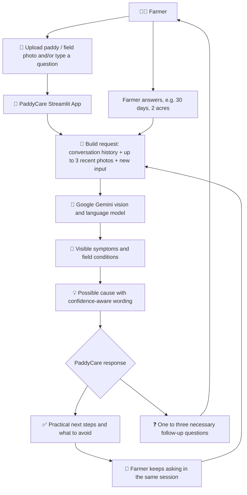
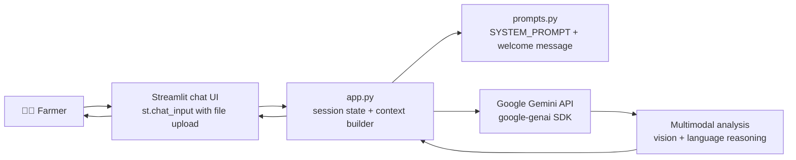

# 🌾 PaddyCare
### AI-Powered Paddy Crop & Field Assistant

**Repository name:** PaddyCare Chatbot


PaddyCare is an AI-powered agricultural assistant that analyzes paddy crop and field images and provides practical, farmer-friendly guidance for understanding visible crop problems, possible causes, and appropriate next steps.

A farmer uploads a photo of a leaf, plant, or field and can then keep asking follow-up questions in the same conversation. PaddyCare answers in simple language (Tamil, Tanglish, or English), reuses the earlier photo and earlier answers, and asks only the few questions it genuinely needs.

> ⚠️ **PaddyCare provides AI-assisted guidance, not a confirmed diagnosis.** A photograph alone cannot verify a disease, a nutrient deficiency, or a pest infestation. Serious or uncertain problems should be checked with a qualified local agricultural professional.

---

## 📌 Problem Statement

Farmers often notice a problem in the field long before they know what it is. What they can see:

- yellowing leaves
- brown or dark spots
- other possible disease symptoms
- pest damage (holes, chewed margins, insects)
- dry, cracked soil
- water stress, or the opposite — waterlogged patches
- uneven crop growth across the field

What they may not know:

- what the visible issue could be
- which details actually matter (crop stage, how far it has spread, recent spraying)
- what immediate, low-risk action may help
- whether fertilizer or a treatment product is even relevant
- what extra information is needed before a safe recommendation is possible

Agricultural expertise is not always immediately available in the field, and generic internet advice ignores the specific crop stage, water condition, and history of that field.

---

## 💡 Solution

PaddyCare combines multimodal AI image analysis with a conversational assistant tuned for paddy farming.

```text
Farmer uploads a photo
        ↓
AI analyzes the visible information
        ↓
Possible problem / visible symptoms identified
        ↓
Previous conversation context is considered
        ↓
Farmer receives simple, practical guidance
        ↓
PaddyCare asks only the necessary follow-up questions
        ↓
Next response uses the previous photo + previous information
```

The assistant deliberately:

- describes what is visible before naming a possible cause
- uses confidence-aware wording and states clearly when a photo is not enough
- never invents a pesticide or fertilizer dose
- prefers the registered product label and local agricultural guidance for anything chemical
- recommends consulting a local agricultural officer or agronomist when a safe answer cannot be established

**PaddyCare provides AI-assisted guidance. It does not replace professional agricultural diagnosis.**

---

## ✨ Key Features

| Feature | Description |
| --- | --- |
| 📸 **Paddy & field image analysis** | Accepts JPG, JPEG, PNG, and WEBP photos of a leaf, plant, or field and analyzes the visible information. |
| 🌾 **Paddy symptom interpretation** | Prompt rules cover leaf colour change, spots, lesions, margins, holes, drying, yellowing, streaking, soil dryness, cracks, standing water, crop density, and uneven growth. |
| 🔎 **Possible problem identification** | States what is visible and one or two most relevant possibilities, instead of forcing a single disease name. |
| 🧠 **Conversation context** | Earlier farmer messages and earlier PaddyCare answers are sent with every new request (capped at 12,000 characters). |
| 🖼️ **Previous photo context** | Up to 3 recent images are retained per session and sent along with a new question, so a follow-up can refer to the previous photo. |
| 💬 **Follow-up conversation** | A continuous chat — questions like "what medicine?", "how to fix this?", "when?" are understood as referring to the latest relevant crop problem. |
| 🇮🇳 **Tamil & Tanglish understanding** | Tamil is answered in Tamil; Tanglish (Tamil typed in English letters) is understood and answered in Tamil script. |
| 🇬🇧 **English support** | An English question receives an English answer. |
| 👨‍🌾 **Farmer-friendly language** | Short sentences, practical instructions, and technical terms explained in simple Tamil. |
| 🌱 **Crop-stage-aware reasoning** | Considers nursery, transplanting, tillering, panicle initiation, booting, flowering, grain filling, and maturity; asks for crop age when it matters. |
| 💧 **Water management guidance** | Discusses moisture, drainage, waterlogging, and irrigation timing in relation to the observed field condition. |
| 💊 **Context-aware fertilizer / treatment guidance** | Guidance is given only when the situation is sufficiently identified; otherwise PaddyCare asks for the minimum missing information first. |
| ⚠️ **Uncertainty-aware responses** | Confidence-aware wording, no over-confident diagnosis, no invented doses, no hallucinated products or field details. |
| 🔁 **Retry & graceful failure** | Transient API/network failures are retried with bounded exponential backoff (1s → 2s → 4s); if the AI cannot be reached, a friendly Tamil message is shown. |
| 🔒 **Secrets kept out of source** | API keys are read from Streamlit secrets and are never written into the code. |
| 🧑‍🌾 **Farmer onboarding & session reset** | A short name onboarding screen, plus a "New Session" button that clears the conversation and stored photos. |
| 🔐 **Session-only memory** | Conversation and photos live only in the Streamlit session state — nothing is written to a database or disk. |

---

## 🔄 How It Works



**Step by step**

1. The farmer opens the app and enters a name (one-time onboarding for the session).
2. The farmer uploads a paddy leaf, crop, or field photo — with or without a question.
3. If only a photo is uploaded, the app automatically attaches a structured analysis instruction: identify the subject, describe visible symptoms, give a preliminary assessment, and ask only the most important follow-ups.
4. On every request the app rebuilds the context: the conversation history (capped at 12,000 characters), up to 3 most recent photos, the follow-up context rule, and the current input.
5. Gemini receives the text plus the images and returns guidance in the farmer's language.
6. If a transient error occurs, the request is retried up to three times with increasing delays; otherwise a friendly fallback message is shown.
7. The reply is stored in the session and rendered in the chat, so the next question can reuse both the photo and everything already said.

---

## 🏗️ System Architecture



**Components actually present**

| Layer | Implementation |
| --- | --- |
| UI | Streamlit chat interface (`st.chat_input` with `accept_file=True`), onboarding form, chat history, "New Session" control |
| Orchestration | `app.py` — session state, context assembly, retry logic, error handling |
| Prompt layer | `prompts.py` — `SYSTEM_PROMPT` (32 behavioural rules) and `WELCOME_MESSAGE_TEMPLATE` |
| AI | Google Gemini via the `google-genai` SDK (`genai.Client`, `types.Part.from_bytes`, `temperature=0.2`, system instruction) |
| State | Streamlit `session_state` only — no database, no vector store, no external backend |

PaddyCare is a single Streamlit application. It has **no** database, vector database, ML training pipeline, REST backend, queue, cache layer, authentication system, or cloud storage.

---

## 🧰 Technology Stack

| Technology | Purpose |
| --- | --- |
| Python | Application logic |
| Streamlit | Web UI and chat interface |
| Google Gemini | Vision + language reasoning |
| google-genai | Gemini API integration |
| Twilio SDK | Reserved for future messaging integration (not active in the current UI) |
| Git / GitHub | Version control and hosting |

---

## 📁 Project Structure

```text
PaddyCare Chatbot/
│
├── app.py                          # Streamlit UI, session state, Gemini calls, retry logic
├── prompts.py                      # System prompt, welcome message, summary prompt
├── requirements.txt                # Python dependencies
├── README.md                       # Project documentation
├── .gitignore                      # Excludes secrets, virtualenvs, caches
│
└── .streamlit/
    ├── secrets.toml                # LOCAL ONLY - real API keys (git-ignored, never committed)
    └── secrets.toml.example        # Committed template showing required key names
```

`venv/` and `__pycache__/` also exist locally but are git-ignored.

**Important files explained**

| File | Purpose |
| --- | --- |
| `app.py` | Entry point. Renders the onboarding form and chat UI, keeps session state (`messages`, `photo_contexts`, `farmer_profile`), assembles the request (conversation history + up to 3 recent photos + new input), calls Gemini with retries, and renders the answer. |
| `prompts.py` | The AI behaviour layer: `SYSTEM_PROMPT` defines the 32 rules for language handling, photo analysis, calibration of confidence, chemical safety, crop stages, answer formats, and follow-up question limits. `WELCOME_MESSAGE_TEMPLATE` is the greeting shown at session start. |
| `requirements.txt` | Runtime dependencies: `google-genai`, `streamlit`, `twilio`. |
| `.streamlit/secrets.toml` | Holds the Gemini API key (and optional Twilio values) locally. Git-ignored — **cannot** be committed. |
| `.streamlit/secrets.toml.example` | Placeholder template with key names only, so another developer knows what to configure. Contains no real credentials. |
| `.gitignore` | Keeps secrets, virtual environments, bytecode caches, logs, and editor files out of version control. |

---

## 🖼️ Screenshots

Screenshots can be added here.

To add your own, place images in an `assets/` folder and reference them with a relative path:

```markdown


```

Suggested screenshots for a quick visual overview:

- the onboarding screen,
- a paddy leaf photo upload with the analysis reply,
- a follow-up question answered from previous context.

---

## 🚀 Installation

**Prerequisites**

- Python 3.10 or newer (developed and verified with Python 3.13)
- A Google Gemini API key from Google AI Studio
- An internet connection (analysis runs through the Gemini API)

**1. Clone the repository**

```bash
git clone https://github.com/abinesh-0/PaddyCare-Chatbot.git
cd PaddyCare-Chatbot
```

**2. Create and activate a virtual environment**

```bash
python -m venv venv
```

Windows:

```bash
venv\Scripts\activate
```

macOS / Linux:

```bash
source venv/bin/activate
```

**3. Install the dependencies**

```bash
pip install -r requirements.txt
```

**4. Configure your API key** — see [Configuration](#-configuration) below.

**5. Run the application**

```bash
streamlit run app.py
```

The app opens in your browser at `http://localhost:8501`.

---

## ⚙️ Configuration

PaddyCare reads its credentials from Streamlit's secrets store. Create the file `.streamlit/secrets.toml` in the project root (you can copy `.streamlit/secrets.toml.example`) and fill in your own values:

```toml
# Required - Google Gemini API key
GEMINI_API_KEY = "your_gemini_api_key_here"
```

| Secret name | Required | Purpose |
| --- | --- | --- |
| `GEMINI_API_KEY` | ✅ Yes | Authenticates the Gemini requests that perform the image and language analysis. |
| `TWILIO_ACCOUNT_SID` | ❌ No | Reserved for a future messaging integration. Not used by the current UI. |
| `TWILIO_AUTH_TOKEN` | ❌ No | Reserved for a future messaging integration. Not used by the current UI. |
| `TWILIO_WHATSAPP_FROM` | ❌ No | Reserved for a future messaging integration. Not used by the current UI. |
| `TWILIO_CONTENT_SID` | ❌ No | Reserved for a future messaging integration. Not used by the current UI. |

> 🔐 **Never commit `.streamlit/secrets.toml`.** It is already listed in `.gitignore`. Without it, only `GEMINI_API_KEY` needs to be present for PaddyCare to run.

**On Streamlit Community Cloud:** paste the same key/value pairs into the app's *Settings → Secrets* editor instead of using a local file.

**Changing the model:** the Gemini model name is set once at the top of `app.py` (`MODEL_NAME`).

---

## 🧑‍🌾 Usage

1. Open PaddyCare (locally at `http://localhost:8501`, or on your deployment URL).
2. Enter your name on the onboarding screen and start the session.
3. Upload a clear photo of a paddy leaf, plant, or field — you can also type a question with it.
4. Ask your question (or upload the photo alone and let PaddyCare analyse it).
5. PaddyCare describes what is visible and gives one or two possible causes, with the confidence level.
6. It lists the practical steps to take now and, when relevant, what to avoid.
7. If important information is missing, it asks only one to three relevant questions — for example crop age, area, water condition, how long the symptom has been present, or recent fertilizer/spray use.
8. Answer the question. PaddyCare combines the previous photo, the earlier conversation, and your new answer in the next response.
9. Use **🔄 New Session** to clear the conversation and stored photos and start fresh.

**Photo tips:** natural daylight, the affected part filling most of the frame, a clear view of the spot pattern, and a second photo of the whole field when the problem is widespread all give better results.

---

## 🗣️ Language Support

PaddyCare adapts its language handling to how the farmer writes, and the rules are enforced through the system prompt.

| Farmer writes | PaddyCare responds |
| --- | --- |
| **Tamil** — asks in Tamil script | Answers completely in simple Tamil. |
| **Tanglish** — Tamil typed using English letters (e.g. *"indha ilayila enna problem?"*) | Understands the intended Tamil meaning and answers in simple Tamil script. |
| **English** — asks in English | Answers in English. |
| **Mixed Tamil + English** | Understands the meaning naturally and replies in the style easiest for the farmer to follow. |

Spelling and grammar are never criticised — Tamil words are used for technical terms where that makes the answer clearer. The greeting and the connection-failure message are shown in Tamil (with familiar English terms such as *photo*, *label*, *upload* kept as-is, as farmers commonly use them).

---

## 💬 Example Interaction

> 📝 **Illustrative example only.** This shows the intended conversation flow, not a real diagnosis and not a guaranteed outcome.

**Farmer** — uploads a photo of a paddy leaf with brown oval spots:

> இந்த இலையில் என்ன problem?

**PaddyCare** — describes what is visible, gives a possible cause with an honesty note, then asks only what it needs:

```text
🌾 பிரச்சனை:
இலையில் பழுப்பு நிறப் புள்ளிகள் காணப்படுகிறது.
இது Brown Spot அறிகுறியாக இருக்கலாம்.
ஆனால் photo மட்டும் இதை உறுதி செய்ய போதாது —
போஷாக்கு குறைபாடு அல்லது தண்ணீர் பிரச்சனையிலும்
இதே மாதிரி தெரியலாம்.

✅ இப்போது செய்ய வேண்டியது:
1. புள்ளிகள் பரவுகிறதா என்று கவனிக்கவும்.
2. வயலில் தண்ணீர் நிலையை சரியாக வைத்திருக்கவும்.
3. ஒரே இலையை அல்ல, முழு செடியின் photo-வையும் எடுக்கவும்.

❓ தேவையான தகவல்:
1. பயிர் எத்தனை நாள் ஆனது?
2. எத்தனை ஏக்கர்?
3. சமீபத்தில் ஏதாவது உரம் அல்லது மருந்து போட்டீர்களா?
```

**Farmer** — answers without re-uploading the photo:

> 30 days, 2 acres. no medicine yet.

**PaddyCare** — combines the earlier photo, the earlier answer, and the new details, so it does not ask for the photo or the crop age again. It then explains, for that stage and area, what to monitor, what water condition to maintain, and whether a treatment is appropriate at all — and if a chemical is genuinely needed, it points to the registered product label and the local agricultural officer for the exact product and dose.

The same flow works in English: an English question receives an English answer.

---

## ⚠️ Safety & Limitations

PaddyCare is deliberately conservative about agricultural advice.

- **AI image analysis can be uncertain.** Lighting, camera angle, image blur, and similar-looking symptoms all affect the result.
- **A photo alone may not confirm a disease.** Several problems — fungal infection, nutrient deficiency, water stress, insect damage, herbicide injury — can look alike in a photograph.
- **Nutrient deficiency usually needs more than a photo.** Visible yellowing or stunting has multiple causes and may require soil information or laboratory testing.
- **Treatment depends on context:** crop stage, location, weather, soil, water condition, previous applications, and the specific product formulation and registration.
- **Exact chemical dosage is not guessed.** PaddyCare does not calculate a dose from crop age alone, does not invent mixing ratios, and does not recommend combining chemicals without authoritative support.
- **Follow the registered product label** and local agricultural department recommendations for any fertilizer or crop-protection product. Respect the label's protective-equipment, re-entry, rain-free, and pre-harvest interval instructions.
- **Verify serious or uncertain cases** with a qualified local agricultural officer, agronomist, or plant pathologist before taking expensive or riskier action.
- **No data retention promises beyond the session:** the conversation and uploaded photos are held in the Streamlit session state for the duration of that session. Uploaded images are sent to the Google Gemini API for analysis and are therefore subject to that provider's terms.

PaddyCare does not replace professional agricultural diagnosis, and it should not be used as the only basis for a decision on pesticide or fertilizer application.

---

## 🔭 Future Scope

The following are **not implemented** today. They are listed as directions for future work:

- **Weather integration** — local rainfall, humidity, and forecast data to sharpen spray-timing and water advice.
- **Voice interaction** — speak the question and hear the answer, for farmers who prefer not to type.
- **Soil test integration** — accept soil test values so nutrient guidance can move from "possible" toward a supported recommendation.
- **Field history** — remember what happened in a field across visits instead of only within one session.
- **Crop-stage tracking** — track the season so the crop stage does not have to be re-entered.
- **Treatment history** — record what was applied and when, to avoid repeat or incompatible applications.
- **Regional agricultural knowledge** — connect to state/regional agricultural department recommendations and local advisories.
- **Messaging integration** — deliver PaddyCare through chat platforms such as Telegram or WhatsApp (a dormant Twilio WhatsApp helper already exists in `app.py` but is not active in the UI).
- **Multilingual voice support** — voice interaction beyond Tamil and English.
- **Low-connectivity / offline improvements** — lighter payloads and graceful behaviour on weak rural connections.

---

## 🗺️ Roadmap

**Implemented and verified in the current codebase**

- [x] Paddy leaf / crop / field image analysis
- [x] Google Gemini vision + language integration
- [x] Photo-only analysis with a structured automatic instruction
- [x] Optional question alongside the photo
- [x] Follow-up conversation in a single session
- [x] Conversation context reuse (capped at 12,000 characters)
- [x] Recent-photo context reuse (up to 3 images per session)
- [x] Tamil support
- [x] Tanglish understanding
- [x] English support
- [x] Tamil-first greeting and fallback message
- [x] Crop-stage-aware reasoning rules
- [x] Water / irrigation guidance rules
- [x] Fertilizer and treatment guidance rules with label-first safety
- [x] Uncertainty-aware, anti-over-diagnosis behaviour
- [x] Bounded retry with exponential backoff (1s → 2s → 4s)
- [x] Friendly fallback message when the AI is unreachable
- [x] API keys read from Streamlit secrets (nothing hardcoded)
- [x] Farmer onboarding and session reset
- [x] Streamlit web UI

**Planned**

- [ ] Weather integration
- [ ] Voice interaction
- [ ] Soil test integration
- [ ] Field history
- [ ] Crop-stage tracking
- [ ] Treatment history
- [ ] Regional agricultural knowledge integration
- [ ] Telegram integration
- [ ] Activate the existing Twilio WhatsApp helper in the UI
- [ ] Multilingual voice support
- [ ] Offline / low-connectivity mode

---

## 🤝 Contributing

Contributions that improve the safety, clarity, or accuracy of the agricultural guidance are welcome.

1. Fork the repository.
2. Create a feature branch: `git checkout -b feature/your-feature-name`
3. Make your change. If you edit `prompts.py`, explain clearly in the pull request **why** the behaviour change is an improvement and how you verified it.
4. Test locally with `streamlit run app.py` using your own API key.
5. Commit with a clear message and open a pull request describing the change.

**Please do not open pull requests that**

- add a hardcoded API key, token, or password
- commit a `.streamlit/secrets.toml` file
- add pesticide or fertilizer dosage guidance that is not traceable to a registered product label or an authoritative agricultural recommendation
- add exaggerated accuracy, safety, or performance claims

**Reporting a security issue:** do not open a public issue. Report it privately to the maintainer instead.

---

## 📄 License

No `LICENSE` file is currently included in this repository. As a result, the default copyright rules apply and the project is **not** granted an open-source licence. If you intend this project to be widely reused, add a `LICENSE` file (for example MIT, Apache-2.0, or GPL-3.0) and update this section accordingly.

---

## 👤 Author & Project Information

| | |
| --- | --- |
| **Project** | PaddyCare — AI-Powered Paddy Crop & Field Assistant |
| **Repository** | PaddyCare Chatbot |
| **Author** | [@abinesh-0](https://github.com/abinesh-0) |
| **Domain** | Agriculture · Computer Vision · Applied Generative AI |
| **Core stack** | Python · Streamlit · Google Gemini (google-genai) |
| **Status** | Working application (active development) |

**Acknowledging the real experts:** PaddyCare is built to help farmers describe and reason about what they see. It is a supplement to — never a substitute for — the knowledge of local agricultural officers, agronomists, and plant pathologists.

> 🌾 *Built to give a farmer a useful first answer, and an honest "I need more information" when the photo is not enough.*
